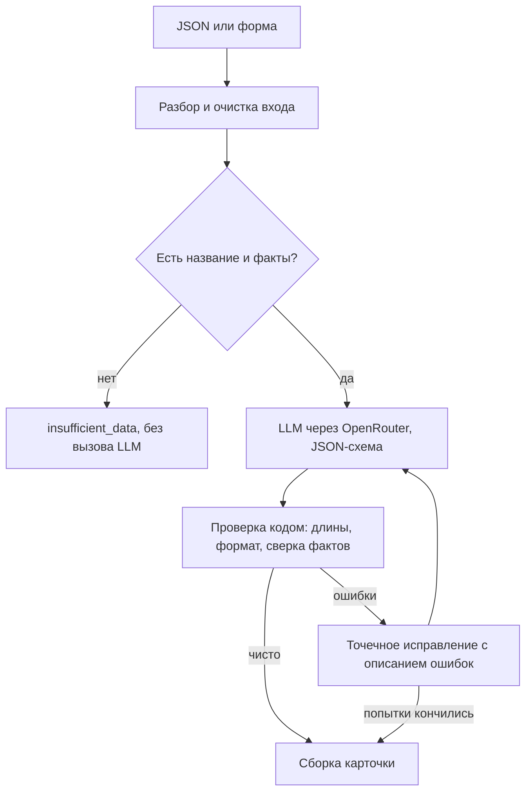

# Карточка товара: AI-помощник для описаний КИП

Прототип сервиса для B2B-магазина контрольно-измерительных приборов. Принимает данные о приборе (JSON или веб-форма) и готовит черновик карточки товара для контент-менеджера:

- SEO-заголовок до 70 символов;
- SEO-описание на 800–1200 символов;
- структурированный список характеристик;
- 3–5 поисковых запросов;
- блок для менеджера: кому подходит прибор и какие задачи решает;
- список того, чего не хватает и что нужно уточнить.

**Главное свойство:** сервис не пропускает выдуманные характеристики. Это проверяет код, а не только просьба в промпте.

## Быстрый старт

Нужны Python 3.11+ и [uv](https://docs.astral.sh/uv/).

```bash
git clone <URL репозитория> product-card-ai
cd product-card-ai
cp .env.example .env        # впишите OPENROUTER_API_KEY
uv sync
uv run product-card serve
```

Откройте http://127.0.0.1:8000. Без ключа интерфейс тоже запустится и подскажет, что его нужно добавить. Сервис слушает только локальный адрес.

По умолчанию используются бесплатные модели OpenRouter, поэтому подойдёт ключ без пополнения баланса. Их лимит — 50 запросов в сутки на аккаунт, а один товар расходует от 1 до 3 запросов и больше, если модель сбоит. Для стабильной работы лучше платная цепочка, см. раздел «Настройка».

<details>
<summary>Запуск без uv</summary>

```bash
python3 -m venv .venv && source .venv/bin/activate
pip install -e .
product-card serve
```
</details>

## Использование

**Веб-интерфейс.** Заполните форму или вкладку JSON, либо возьмите готовый пример. Результат можно скопировать целиком (JSON, Markdown, текст) или по блокам.

**Командная строка:**

```bash
uv run product-card generate examples/input/*.json -o examples/output
```

Код возврата: `0` — успешно, `1` — ошибка, `2` — карточка требует правки или данных мало.

**API:**

```bash
curl -s http://127.0.0.1:8000/api/generate \
  -H 'Content-Type: application/json' \
  -d @examples/input/manometer_dm02.json
```

Статус результата показывает, что делать с карточкой дальше:

| Статус | Значение |
|---|---|
| `ready` | Проверка пройдена, уточнять нечего |
| `needs_clarification` | Проверка пройдена, но каких-то данных нет или они вызывают вопросы |
| `needs_review` | После всех попыток остались ошибки: они перечислены в `issues` |
| `insufficient_data` | Данных слишком мало, LLM не вызывалась |

## Примеры результата

Результаты лежат в [`examples/output/`](examples/output/) и не правились вручную:

| Товар | Статус | Что показывает |
|---|---|---|
| Манометр DM 02, товар из текста задания | `needs_clarification` | Проверка пройдена. Код заметил, что описание во входных данных обрывается многоточием |
| Преобразователь ДЕМО-100, демонстрационный товар | `needs_clarification` | Проверка пройдена. Отсутствующие поля помечены «данных нет», питание взято из описания с цитатой, спорный диапазон не попал в текст и вынесен вопросом менеджеру |

**Как получены примеры.** Командой `product-card generate` через OpenRouter API на бесплатной модели `nvidia/nemotron-3-ultra-550b-a55b:free`, с правилами и промптом из этого репозитория. Эта модель нестабильна: одни запуски заканчиваются статусом `needs_review`, другие проходят проверку. В примерах сохранены первые прошедшие запуски: второй для DM 02 и третий для ДЕМО-100. Отдельные неудачные обороты и опечатки модели («вентля») код не проверяет, поэтому результат остаётся черновиком для контент-менеджера.

В задании говорится о данных по двум товарам, но в файле был только пример DM 02. Поэтому второй товар я составил сам и намеренно сделал его неполным: в нём нет производителя, значение корпуса пустое, питание указано только в описании, а диапазон в описании расходится с характеристиками.

### Прогон через платную модель

В [`examples/output/paid-haiku/`](examples/output/paid-haiku/) — тот же ввод, но `anthropic/claude-haiku-5.5` через OpenRouter (режим `schema`, `LLM_DATA_COLLECTION=deny`), прогон от 2026-11-02:

| Товар | Статус | Попытки | Токены (промпт/генерация) | Стоимость |
|---|---|---|---|---|
| Манометр DM 02 | `needs_clarification` | 3 | 9749 / 2056 (суммарно за попытки) | $0.0020 |
| Преобразователь ДЕМО-100 | `needs_clarification` | 2 | 6560 / 1666 | $0.0015 |

Оба товара — без ошибок валидации (`issues` пуст): цикл исправлений отработал по делу. На первой попытке DM 02 описание оказалось короче 800 символов, на второй — неподтверждённое утверждение; код дал модели её свой ответ и конкретный список ошибок, и третья попытка прошла. Разница с бесплатной моделью видна на ДЕМО-100: nemotron осмелился вынести питание 24 В в характеристики с дословной цитатой из описания, а Haiku не стала — безопаснее «данных нет» и вопрос менеджеру. Оба ответа правильные по правилам проекта: цена смелости — лишняя ручная проверка, цена осторожности — поле, которое менеджер заполнит сам.

Время генерации: DM 02 — 14.5 с, ДЕМО-100 — 10.1 с (против ~91 с у бесплатных моделей; локальная Qwen 4B пишет заметно слабее и часть запусков заканчивает непригодным форматом). Итого за оба товара Haiku стоила $0.0035.

## Что проверено на живых моделях

Прогоны — командой `product-card generate` на обоих товарах из [`examples/input/`](examples/input/), 2026-11-02. Данные реальные: токены и стоимость взяты из ответа API (`meta` результата).

| Режим | Что проверено | Результат |
|---|---|---|
| OpenRouter API, платный `anthropic/claude-haiku-5.5`, режим `schema`, `LLM_DATA_COLLECTION=deny` | Командная строка: оба товара, цикл исправлений, сверка фактов, стоимость | Работает. Манометр DM 02: 3 попытки (9749 промпт- + 2056 генерированных токенов суммарно), 14.5 с, $0.0020, статус `needs_clarification` — цикл исправлений отработал по делу: сначала описание короче 800 символов, потом неподтверждённое утверждение. ДЕМО-100: 2 попытки (6560 + 1666 токенов), 10.1 с, $0.0015, `needs_clarification`. Итого $0.0035 за оба товара, выдумок сверка не нашла, `issues` пуст |
| OpenRouter API, ключ без пополнения, бесплатная `nemotron-3-ultra-550b` | Командная строка: разбор ответа, цикл исправлений | Работает. Модель нестабильна: часть запусков получает `needs_review` или упирается в лимиты и таймауты. Примеры в `examples/output/` — с этой модели |
| Локальная модель Qwen 3.5 4B (`fredrezones55/Qwen3.5-Uncensored-HauhauCS-Aggressive:4b`) в Ollama через OpenAI-совместимый endpoint | Командная строка и веб-интерфейс целиком: форма, POST `/api/generate`, карточка, статус, подсветка ошибок | Работает. Командная строка: манометр DM 02, 3 попытки, 54 с, `needs_review` — модель не дотягивает описание до 800 символов и вставляет «щитового», чего нет во входных данных; сверка отклоняет. Веб-интерфейс: тот же товар через POST `/api/generate`, HTTP 200 за 96 с, `needs_review`, а сверка отбросила 4 вытащенных из описания значения без цитат (`extracted_spec_rejected`) и 2 выдуманных утверждения. Часть запусков заканчивается неверным форматом (модель возвращает саму JSON-схему вместо карточки), и тогда код поднимает `llm_bad_output` — поведение описано в «Ограничениях» |

Выводы: платная цепочка (`claude-haiku-5.5`) даёт черновик, который почти не требует правок, и стоит копейки — $0.003 за оба товара. Бесплатные модели хватает для проверки всей механики, но не для качества. Локальная 4B-модель годится для офлайн-демонстрации защиты от выдумок: её ошибки сверка ловит и помечает, но текст ей нужно дописывать вручную.

Повторить прогоны:

```bash
# Платная модель через OpenRouter (списывает копейки с пополненного ключа)
LLM_MODELS=anthropic/claude-haiku-5.5 LLM_ESCALATION_MODELS=anthropic/claude-haiku-5.5 \
LLM_OUTPUT_MODE=schema LLM_DATA_COLLECTION=deny LLM_REASONING_EFFORT=none \
uv run product-card generate examples/input/*.json -o examples/output/paid-haiku

# Локальная модель через Ollama (бесплатно, но медленно и слабее)
OPENROUTER_BASE_URL=http://localhost:11434/v1 OPENROUTER_API_KEY=local \
LLM_MODELS=<модель из ollama list> LLM_ESCALATION_MODELS=<та же модель> \
LLM_OUTPUT_MODE=prompt LLM_TIMEOUT_SECONDS=270 LLM_REASONING_EFFORT=none \
uv run product-card generate examples/input/*.json -o examples/output/ollama
```

## Как устроена защита от выдумок



Защита состоит из пяти уровней:

1. **Характеристики не проходят через LLM.** Значения в таблице код копирует из входных данных, поэтому модель не может их исказить. Для отсутствующего поля код пишет «данных нет».
2. **Каждый факт в тексте сверяется со входом** ([`grounding.py`](src/product_card/grounding.py)). Код извлекает числа с единицами (в том числе написанными словом), обозначения (`G1/4`, `IP65`, `RS-485`, `ГОСТ…`), названия, ссылки и контакты, а также утверждения без цифр: материалы, поверку, гарантию, сертификаты, рекламные оценки. Чего нет во входных данных, то считается ошибкой. Ошибкой считаются и пересчёт `1,6 МПа` в `16 бар`, и значение чужого поля: «класс точности 1,6», если 1,6 есть только в диапазоне.
3. **Значения из описания нужно подтвердить цитатой.** Модель может взять характеристику из паспортного текста, только если приведёт дословный фрагмент. Код проверяет, что он там есть и содержит и название параметра, и значение.
4. **Противоречия находит код.** Если описание и характеристики расходятся в значении одного параметра, значение из описания запрещается к использованию, а менеджер получает вопрос. Это не зависит от того, заметила ли расхождение модель.
5. **Что не удалось исправить, не выглядит готовым.** Такая карточка получает статус `needs_review`, а в интерфейсе подсвечиваются спорные значения.

## Промпт

Текст находится в [`prompts.py`](src/product_card/prompts.py). Основные решения:

- **Данные отделены от инструкций.** Вход передаётся как JSON в теге `<product_data>`, символ `<` экранируется, поэтому данные не могут закрыть тег. Системный промпт объявляет его содержимое данными. Если там встречается команда, модель должна сообщить об этом менеджеру.
- **Запрет сформулирован конкретно.** Перечислено, что нельзя добавлять, и что значит «выдумать»: типичные для прибора значения, пересчёт, округление, чужие единицы.
- **Для скудных данных есть безопасный способ набрать объём.** Текст объясняет, зачем покупателю сверять указанные параметры с задачей, не добавляя новых фактов. Без этого правила модель при нехватке данных склонна их выдумывать.
- **Структурированный вывод.** Ответ задан строгой JSON-схемой, разбирается Pydantic и затем проверяется кодом.
- **Точечное исправление.** Вместо повторной генерации модель получает свой ответ и конкретные ошибки, например: «В описании 1310 символов, максимум 1200: сократите минимум на 110».
- **Версия промпта.** Она входит в ключ кэша и в метаданные результата.

## Принятые решения

| Решение | Почему |
|---|---|
| Python, FastAPI, Pydantic | Сильная валидация данных и минимум кода |
| Интерфейс без сборки и зависимостей | Запуск одной командой и строгий CSP |
| OpenRouter с цепочкой моделей | При сбое одной модели запрос автоматически уходит следующей, а модель меняется одной строкой в `.env` |
| Отдельная цепочка для последней попытки | Если проверка не пройдена, последнее исправление можно отдать более сильной модели |
| Два режима формата ответа | Строгая JSON-схема отсекает многие бесплатные модели. В режиме `prompt` формат описан в промпте, а код всё равно проверяет ответ. Этот режим включён по умолчанию |
| Ожидаемые поля зависят от типа прибора | У механического манометра нет питания, и незачем требовать его у менеджера |

## Безопасность

- **Ключ** хранится только в `.env` (файл в `.gitignore`), в коде — как `SecretStr`. Он не попадает в логи и ответы. HTTP-клиент не следует редиректам, а адрес LLM должен быть HTTPS.
- **Защита локального сервиса.** Он слушает `127.0.0.1`. Проверка заголовка `Host` защищает от DNS rebinding, проверка `Origin` (с портом), `Sec-Fetch-Site` и `Content-Type` — от запросов с чужих сайтов, которые могли бы тратить ваш ключ.
- **Заголовки:** строгий CSP без inline-скриптов, запрет встраивания в iframe, `nosniff`, `no-referrer`.
- **Лимиты:** размер запроса (в том числе без `Content-Length`), частота запросов, число одновременных генераций, число попыток, предельная цена токена на стороне OpenRouter.
- **Вход и вывод.** Из входа удаляются управляющие и невидимые символы, которыми можно спрятать инструкции. Интерфейс выводит данные только через `textContent`, Markdown-экспорт экранирует разметку. Ошибки не содержат входных данных и ответов внешнего API.
- **Данные.** Бесплатные модели могут сохранять запросы, поэтому по умолчанию стоит `LLM_DATA_COLLECTION=allow`: не отправляйте через них закрытые данные. С платными моделями используйте `deny`, а `LLM_ZDR=true` оставляет только endpoints без хранения.

## Оптимизация

- Одинаковый запрос берётся из кэша и ничего не стоит (TTL и LRU, настраивается).
- Одновременные одинаковые запросы объединяются в один, поэтому двойной клик не оплачивается дважды.
- Неполные данные отсеиваются до вызова LLM.
- Исправление посылается, только если есть ошибки, причём модель получает свой ответ и конкретный список ошибок, а не начинает заново.
- Используется один HTTP-клиент с keep-alive, статика сжимается. Стоимость и токены показаны в результате.

## Настройка

Основные параметры с пояснениями перечислены в [`.env.example`](.env.example), остальные (таймауты, ценовые лимиты, разрешённые хосты) — в [`config.py`](src/product_card/config.py).

Локальная модель через Ollama или другой OpenAI-совместимый сервер. Цепочки моделей здесь нет, используется первая модель из `LLM_MODELS`:

```bash
OPENROUTER_BASE_URL=http://localhost:11434/v1
OPENROUTER_API_KEY=local
LLM_MODELS=имя_модели_из_ollama_list
LLM_ESCALATION_MODELS=имя_модели_из_ollama_list
LLM_REASONING_EFFORT=none
LLM_TIMEOUT_SECONDS=270
```

Платная цепочка для пополненного аккаунта. Проверена на живом API 2026-11-02: оба товара из `examples/input/` прошли со статусом `needs_clarification`, цикл исправлений отработал, стоимость составила $0.0035 за оба товара (`claude-haiku-5.5`, режим `schema`).

```bash
LLM_MODELS=anthropic/claude-haiku-5.5,openai/gpt-5.6-luna,google/gemini-3.1-flash-lite
LLM_ESCALATION_MODELS=anthropic/claude-sonnet-5.5,openai/gpt-5.6-terra
LLM_OUTPUT_MODE=schema
LLM_DATA_COLLECTION=deny
```

## Разработка

```bash
uv sync
uv run pytest
uv run ruff check .
uv run mypy
```

Тесты не обращаются к сети. Посмотреть интерфейс без ключа можно на заранее заданных ответах:

```bash
uv run python -m tests.dev_server
```

Откроется на http://127.0.0.1:8765. Это режим разработки: LLM в нём не вызывается, ответы заранее заданы и не зависят от введённых данных.

## Ограничения

- Сверка фактов рассчитана на русский текст и типовые единицы. Необычную единицу код может не распознать как единицу, хотя само число всё равно будет проверено.
- Привязка значения к полю работает, когда значение идёт после названия параметра. Обратный порядок («1,6 — класс точности») не проверяется, хотя само число должно быть во входных данных.
- Проверка строгая: иногда она отклоняет верную формулировку, что стоит одной лишней попытки. Я выбрал такой компромисс намеренно, потому что выдуманная характеристика в B2B-каталоге обходится дороже.
- Смысл текста код проверяет только по списку слов и шаблонов. Неподтверждённое свойство, сформулированное незнакомыми словами, грамматические ошибки и неудачные обороты могут пройти. Поэтому результат остаётся черновиком и требует проверки.
- Бесплатные модели работают медленно (десятки секунд на попытку), часто сбоят и дают разный результат от запуска к запуску, поэтому один и тот же товар может получить разный статус.
- Маленькие локальные модели (4B параметров) иногда не выполняют инструкцию формата и возвращают саму JSON-схему вместо карточки — все попытки заканчиваются `llm_bad_output`, и команда завершается с кодом 1. Повторный запуск может пройти: ответы модели непредсказуемы. Для реальной работы такие модели не годятся, только для демонстрации защиты от выдумок.
- Числительные словами распознаются от двух и выше, кроме составных («двадцать пять»). Регистр единиц не учитывается (`МПа` и `мПа` считаются одной единицей).
- Если ответ модели оказался непригоден (например, обрезан по лимиту токенов), его стоимость не попадает в `meta`, хотя OpenRouter её учитывает.
- Кэш и лимиты хранятся в памяти и сбрасываются при перезапуске. Авторизации нет, сервис рассчитан только на локальный запуск.

## Что можно улучшить

- Импорт паспортов из PDF и пакетная обработка каталога из CSV или Excel.
- Каталог типов приборов с обязательными полями вместо набора правил в коде.
- Набор эталонных товаров для регрессионной оценки качества при смене промпта или модели.
- Отслеживание правок менеджера для улучшения промпта.
- Выгрузка в CMS магазина.
